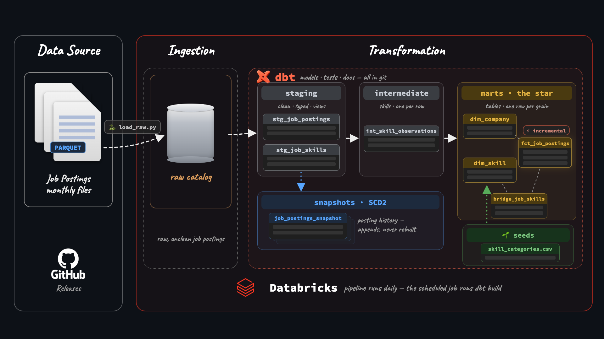

# Production Job Postings Pipeline (v2) - dbt + Databricks

A production **dbt** pipeline on **Databricks** with raw job posting scrapes, rebuilt monthly by a scheduled job.

- Shapes medallion layers into a tested star schema.
- Tracks a year of salary histroy with SCD2 snapshots.
- Loads incrementally and runs itself on a scheduled Databricks Job.

**this is a v2 version of the pipeline** - [v1](https://github.com/anlu18ab/dbt-duckdb-pipeline) buit the foundations of the pipeline on DuckDB + GitHub Actions. v2 uses the same dataset and moves it to a real warehouse in Databrickcs, implements SCD2 history, incremental loads, and a scheduled monthly job.

| What was built | How I implemented | Where to look |
| --- | --- | --- |

## The dbt Pipeline

## Production

** Databricks** is used for the runtime, storage, compute, and the schedule.

- ** Dev and Prod as catalogs**: the builds land in the `dev` catalog, while the scheduled job writes those same schemas into `prod`
- **Scheduled Databricks Job** runs the complete pipeline monthly: `load_raw` (ingestion notebook), then `dbt deps` -> `dbt debug` -> ´dbt build`, pulling the repo straight from GitHub.

## Snapshots
The marts keep the job's latest scrape, the snapshot table keeps **every version**, adhering to Slowly Changing Dimensions type 2 (SCD2) over watched columns:

## Docs

Structure, tests, and column descriptions can be found in the docs site:

** -> [github.com/anlu18ab/dbt-databricks-pipeline]()**

## Run it yourself

